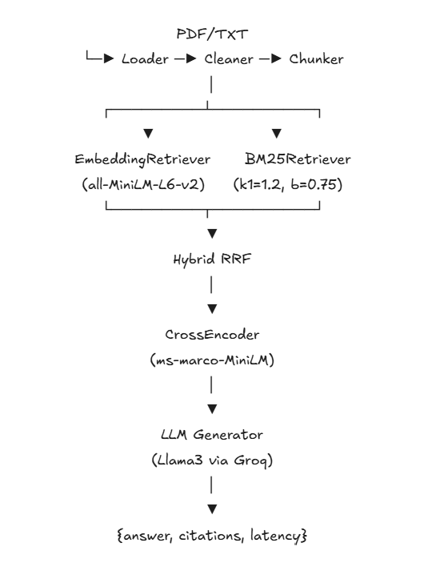

# RetrievalLab: Hybrid RAG System with Evaluation Harness

> Document Q&A over SKCET Code of Conduct — combining BM25, 
> dense retrieval, cross-encoder reranking, and grounded 
> LLM answers with citations.

[Live Demo](#) | [GitHub](#)

---

## Results

Evaluated on 32 answerable + 8 negative questions (tuning set).  
Final numbers from held-out 10-question test set.  
Chunk config: **150 words, 30-word overlap** | BM25: **k1=1.2, b=0.75**

### Retrieval Performance (tuning set)
| Stage           | Hit@5  | MRR    | MAP    |
|-----------------|--------|--------|--------|
| BM25 only       | 0.3750 | 0.2881 | 0.2474 |
| Dense only      | 0.5000 | 0.3404 | 0.3133 |
| Hybrid RRF      | 0.4688 | 0.3223 | 0.2892 |
| Hybrid + Rerank | 0.5312 | 0.3516 | 0.2969 |

### Final Evaluation (holdout set — Hybrid + Rerank)
| Hit@5  | MRR    | MAP    | Refusal Accuracy |
|--------|--------|--------|------------------|
| 0.8750 | 0.7083 | 0.4271 | 8/8 (1.0)        |

### Citation Accuracy (manual, 10 questions)
| Answer correct | Citation present | Chunk matches ground truth |
|----------------|------------------|---------------------------|
| 9/10           | 10/10            | 7/10                      |

> Citation mismatch occurs when the answer exists in multiple 
> adjacent chunks due to 30-word overlap.

---

## Why Hybrid Retrieval

BM25 handles exact terms (rule numbers, percentages, 
policy names) well but fails on paraphrase.  
Dense retrieval handles paraphrase but misses exact identifiers.  
RRF combines both rankings without score-scale mismatch.  
Cross-encoder reranking adds full query-document attention 
as a final scoring pass.

This was validated empirically: BM25 MRR (0.288) > Dense MRR 
(0.340) on exact-term queries; Dense wins on paraphrase.  
Hybrid + Rerank achieves the best overall MRR (0.352) on 
the tuning set.

---

## Architecture




## Pipeline

1. **Ingestion:** PDF/TXT extraction with pdfplumber, 
   whitespace and header cleaning
2. **Chunking:** Word-based, 150 words, 30-word overlap, 
   global chunk IDs with source metadata
3. **Indexing:** `all-MiniLM-L6-v2` embeddings (cached) 
   + BM25Okapi index (pickled)
4. **Retrieval:** Top-20 candidates from each retriever, 
   merged with Reciprocal Rank Fusion
5. **Reranking:** `cross-encoder/ms-marco-MiniLM-L-6-v2` 
   over top-20 candidates → top-5
6. **Generation:** Groq-hosted Llama3, grounded to context, 
   with citation and refusal handling
7. **API:** FastAPI — `/health`, `/index`, `/search`, `/ask`

---

## Limitations

- Text-based PDFs only; scanned/image PDFs not supported
- All retrieved chunks returned as citations; 
  per-sentence attribution not implemented
- Refusal tested on clearly out-of-scope queries; 
  near-miss hallucination not evaluated
- Cross-encoder reranking adds ~800ms latency per query
- Eval set (40 tuning + 10 holdout) is small; 
  results may not generalise to all query types

---

## Tech Stack

Python · FastAPI · sentence-transformers · 
rank-bm25 · NumPy · Groq API · Pydantic

---

## Setup

```bash
git clone https://github.com/yourusername/retrieval-lab
cd retrieval-lab
python -m venv .venv
source .venv/bin/activate  # Windows: .venv\Scripts\activate
pip install -r requirements.txt
cp .env.example .env       # add GROQ_API_KEY
```

Place documents in `data/docs/`, then:

```bash
uvicorn app.main:app --port 8000
# API docs at http://localhost:8000/docs
```

---

## Evaluation

```bash
# label chunks after indexing
python scripts/label_chunks.py

# run all retrieval modes against tuning set
python scripts/run_eval.py

# final holdout evaluation (run once)
python scripts/run_holdout.py

# refusal accuracy
python scripts/eval_refusal.py
```

---

## Future Improvements

- Async re-indexing pipeline for user document uploads
- Sentence-level citation attribution
- Expanded eval set with near-miss negative questions
- BM25 + embedding fine-tuning on domain-specific data